<!-- Generated by scripts/build.mjs from profile.config.json. Edit those, not this file. -->

<a href="https://idreex.netlify.app"><picture><source media="(prefers-color-scheme: dark)" srcset="assets/hero-dark.svg"></picture></a>

<a href="https://idreex.netlify.app"><picture><source media="(prefers-color-scheme: dark)" srcset="assets/btn-site-dark.svg"></picture></a>&nbsp;<a href="https://www.linkedin.com/in/muhammadidrees538"><picture><source media="(prefers-color-scheme: dark)" srcset="assets/btn-li-dark.svg"></picture></a>&nbsp;<a href="mailto:idreesdev538@gmail.com"><picture><source media="(prefers-color-scheme: dark)" srcset="assets/btn-mail-dark.svg"></picture></a>

<picture><source media="(prefers-color-scheme: dark)" srcset="assets/now-dark.svg"></picture>

<picture><source media="(prefers-color-scheme: dark)" srcset="assets/label-work-dark.svg"></picture>

<a href="https://thecarblock.com"><picture><source media="(prefers-color-scheme: dark)" srcset="assets/project-carblock-dark.svg"></picture></a> <a href="https://mesureos.com"><picture><source media="(prefers-color-scheme: dark)" srcset="assets/project-mesureos-dark.svg"></picture></a>

<picture><source media="(prefers-color-scheme: dark)" srcset="assets/project-boxing-dark.svg"></picture> <picture><source media="(prefers-color-scheme: dark)" srcset="assets/project-dashboards-dark.svg"></picture>

<picture><source media="(prefers-color-scheme: dark)" srcset="assets/label-stack-dark.svg"></picture>

<picture><source media="(prefers-color-scheme: dark)" srcset="assets/stack-dark.svg"></picture>

Every image here is a hand-drawn SVG with light and dark versions. A GitHub Action redraws the numbers every night.

